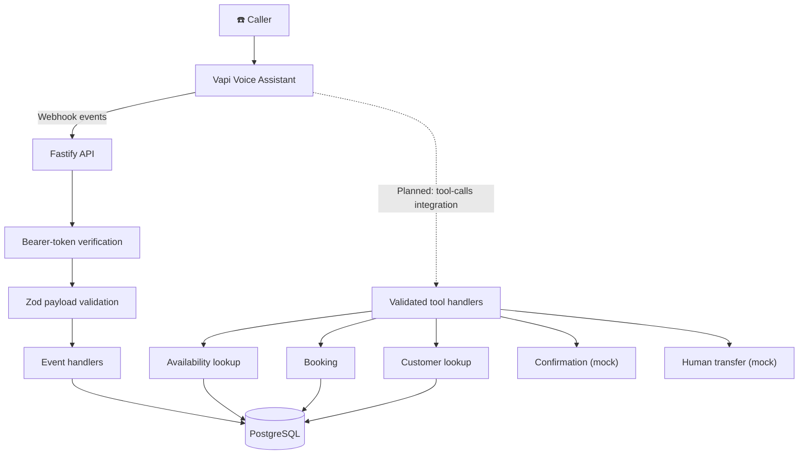

<div align="center">

# 🎙️ AI Voice Agent
### Intelligent Booking Receptionist for AI Automation Agencies

<p>
  
  
  
  
</p>

<p>
  <strong>A voice-first receptionist that helps prospective customers book demos.</strong><br>
  Built with a typed webhook backend, validated tools, replay-safe call persistence, and a phased path toward a live booking experience.
</p>

<p>
  <a href="#-overview">Overview</a> ·
  <a href="#-architecture">Architecture</a> ·
  <a href="#-current-status">Status</a> ·
  <a href="#-quick-start">Quick start</a> ·
  <a href="#-roadmap">Roadmap</a>
</p>


</div>

## ✨ Overview

This project is a Node.js/TypeScript backend for a **Vapi-powered AI booking receptionist**. The receptionist is designed to answer prospective customers in English, help them find an available demo slot, and support booking-related workflows.

The backend is being built in small, verifiable phases. The current foundation includes a Fastify server, validated environment configuration, Prisma persistence, a secured Vapi webhook, and five Zod-validated tools with dependency-injected handlers.

> [!IMPORTANT]
> **Integration status:** The backend foundation and local tool tests exist, but a live Vapi call has not yet been verified. The Phase 5 tools are not yet wired into a live `tool-calls` event. This README distinguishes implemented work from planned work.

## 🚀 Highlights

- **Typed backend** — Node.js, TypeScript, and Fastify.
- **Validated configuration** — environment variables are validated with Zod.
- **Secured webhook** — constant-time bearer-token comparison.
- **Replay-safe persistence** — final transcripts are stored without duplicate records.
- **Call artifacts** — end-of-call artifacts are persisted.
- **Booking safety** — slot claiming uses conditional updates.
- **Tool-first design** — five Zod-validated tools with injected handlers.
- **Privacy-conscious logs** — phone numbers are masked.
- **Local test suite** — Vitest; nine tests were passing at the Phase 5 handoff.
- **Explicit phased workflow** — no commits or pushes without approval.

## 🧭 Architecture



### Stack

| Layer | Technology | Purpose |
|---|---|---|
| Runtime | Node.js + TypeScript | Typed server-side application |
| HTTP | Fastify | Webhook and API server |
| Validation | Zod | Environment, payload, and tool-input validation |
| Database | PostgreSQL | Calls, transcripts, appointments, and availability |
| ORM | Prisma | Schema, migrations, and database access |
| Voice platform | Vapi | Voice assistant and webhook events |
| Testing | Vitest | Automated tests |
| Code quality | ESLint + Prettier | Linting and formatting |

## 📍 Current Status

| Phase | Scope | Status |
|---|---|---|
| 1 | Project scaffold and tooling | ✅ Complete |
| 2 | Prisma schema, migration, local seed | ✅ Complete |
| 3 | Fastify server, Zod env validation, masked logger, health endpoint | ✅ Implemented; uncommitted |
| 4 | Secured Vapi webhook and replay-safe persistence | ✅ Implemented; local testing only; uncommitted |
| 5 | Availability slots and five validated tools | ✅ Implemented; 9 tests reported passing; uncommitted |
| 6 | Wire tool calls and deterministic post-call processing | 🟡 Plan/approval pending |
| 7 | Dashboard: KPIs, chart, intents, summaries | ⏳ Planned |
| 8 | Live call updates | ⏳ Planned |
| 9 | Calendar, CRM, and email integrations | ⏳ Planned |
| 10 | Human handoff and multilingual support | ⏳ Planned |
| 11 | Expanded tests and test-call checklist | ⏳ Planned |
| 12 | GitHub Actions CI and deployment docs | ⏳ Planned |

**Current branch:** `feat/voice-agent-phase-1`

### Known gaps

- No live Vapi call has been made; Vapi retry behavior is unverified.
- `durationSec` is currently `null`, and `endedAt` uses webhook receipt time because the relevant payload fields have not yet been verified against a real end-of-call payload.
- `tool-calls`, `assistant-request`, transfer, and knowledge-base events are acknowledged but not executed.
- The `{{RECORDING_NOTICE}}` prompt placeholder needs load-time substitution and a regression test.
- The seed currently contains one slot that is already booked; open slots should be generated relative to the current date.
- Transaction atomicity, the `startsAt` uniqueness constraint, and the double-booking race test still need explicit verification.
- Phase 3, 4, and 5 changes are currently uncommitted and should remain separate commits.

## 🛠️ Tools

The Phase 5 tool layer contains five Zod-validated tools:

| Tool | Current behavior |
|---|---|
| Slot lookup | Finds available booking slots |
| Booking | Attempts to claim a slot and create an appointment |
| Customer lookup | Looks up customer information |
| Send confirmation | Mock implementation |
| Human transfer | Mock implementation |

> The tools are implemented behind dependency-injected handlers, but are **not yet connected to a live Vapi tool-call flow**. Do not treat mock confirmation or transfer as a production integration.

## 🧪 Quick Start

These steps describe the intended local setup. Check the repository's actual scripts and package manager before running commands; the exact commands may vary with the current project configuration.

### Prerequisites

- Node.js version supported by the project
- Local PostgreSQL
- A package manager matching the repository lockfile
- A Vapi account for live-call testing
- A public HTTPS tunnel (for example, ngrok) when exposing a local webhook

### 1. Clone the repository

```bash
git clone <YOUR_GITHUB_REPOSITORY_URL>
cd <YOUR_REPOSITORY_DIRECTORY>
git switch feat/voice-agent-phase-1
```

Replace the placeholders with the actual repository URL and directory name.

### 2. Configure environment variables

Copy the example environment file and fill in local values according to the project's Zod environment schema.

```bash
cp .env.example .env
```

Generate a webhook token locally:

```bash
openssl rand -hex 32
```

Set the generated value as `VAPI_WEBHOOK_TOKEN` in your **local, untracked** `.env` file. Never paste real secrets into source code, screenshots, issues, or committed files.

> [!CAUTION]
> Verify that `.env` is ignored by Git and is not tracked. If it was previously tracked, remove it from the index with `git rm --cached .env` and commit that removal. Keep `.env.example` limited to placeholder values.

### 3. Configure PostgreSQL

Create a local database named `voice_agent`, then configure the database connection using the environment-variable name expected by the project.

Run the repository's Prisma migration and seed scripts using the package manager and scripts defined in `package.json`. Do not assume the seed currently provides an available slot; open slots are a known pending fix.

### 4. Start the server and run checks

Use the actual scripts in `package.json`. Typical script names may look like:

```bash
npm run dev
npm test
npm run lint
```

These are examples, not a guarantee that the repository uses these exact script names.

Check the health endpoint locally:

```bash
curl http://localhost:<PORT>/health
```

Expected response:

```json
{"status":"ok"}
```

Use the configured port from the local environment. A healthy endpoint confirms the server is responding; it does **not** verify a live Vapi call.

## 🔐 Security & Reliability

- Keep `.env` local and untracked; commit only placeholder configuration in `.env.example`.
- Validate external payloads before processing them.
- Authenticate webhook requests with the configured bearer token.
- Use constant-time comparison for secret checks.
- Mask phone numbers in logs.
- Keep call persistence replay-safe.
- Verify transaction boundaries and race-condition behavior before relying on booking in a live demo.
- Never fabricate undocumented Vapi payload fields or post-call summaries.
- Never commit or push without explicit approval.

## 🗺️ Roadmap

### Phase 6 — Tool calls + post-call processing

1. Verify the official Vapi documentation for the exact `tool-calls` request and response format.
2. Connect validated Vapi tool calls to the existing Phase 5 handlers.
3. Persist a summary only if its presence and shape are verified in official documentation; otherwise leave the existing summary unchanged.
4. Classify intent deterministically: recorded tool actions first, conservative transcript keyword rules second, enum fallback last.
5. Ask for clarification before changing an enum that has no fallback value.
6. Record only action results documented by Vapi.
7. Test each rule, including precedence and fallback.

**Implementation rule:** prepare a plan and wait for explicit approval before writing code.

### Later phases

- **Phase 7:** Dashboard for KPIs, charts, intents, and summaries from persisted data.
- **Phase 8:** Live call updates.
- **Phase 9:** Google Calendar, CRM, and email integrations.
- **Phase 10:** Human handoff and multilingual support.
- **Phase 11:** Expanded tests and a repeatable test-call checklist.
- **Phase 12:** GitHub Actions CI and deployment documentation.

## 📞 Live Demo Checklist

Before the first live test call:

- [ ] Vapi account configured.
- [ ] Phone number or supported test-call option available.
- [ ] Assistant configured with the current system prompt.
- [ ] `VAPI_WEBHOOK_TOKEN` configured securely on the server and matched to the webhook setup.
- [ ] Public HTTPS tunnel points to the local server.
- [ ] Webhook URL and authentication settings verified.
- [ ] At least one future, open availability slot exists.
- [ ] Recording notice placeholder is resolved before the prompt is sent.
- [ ] Tool-call response shape verified against official Vapi documentation.
- [ ] One real end-of-call payload captured safely for field mapping.
- [ ] Phone numbers and other sensitive values redacted before sharing logs or payloads.
- [ ] Booking, retry, and duplicate-event behavior checked.

## 🤝 Development Workflow

This project follows an approval-first workflow:

1. Propose a scoped phase plan.
2. Wait for explicit approval.
3. Read the official documentation before integration work.
4. Implement and test only the approved scope.
5. Report **VERIFIED / UNVERIFIED / KNOWN GAPS / NEXT PHASE** at the end of each phase.
6. Never commit or push without explicit approval.

### Suggested commit separation

The existing uncommitted work should be reviewed and split into three separate commits:

1. Phase 3 — server foundation and health endpoint.
2. Phase 4 — Vapi webhook and call persistence.
3. Phase 5 — availability slots and tool handlers.

Before committing, verify `.env` is not tracked and that no secrets are staged.

## 📄 License

No license has been specified yet. Add a `LICENSE` file before presenting this repository as open source.

---

<div align="center">

### Built for reliable conversations — one verified phase at a time.


<sub>Documentation reflects the project handoff state. Update the status table as phases are verified.</sub>

</div>
